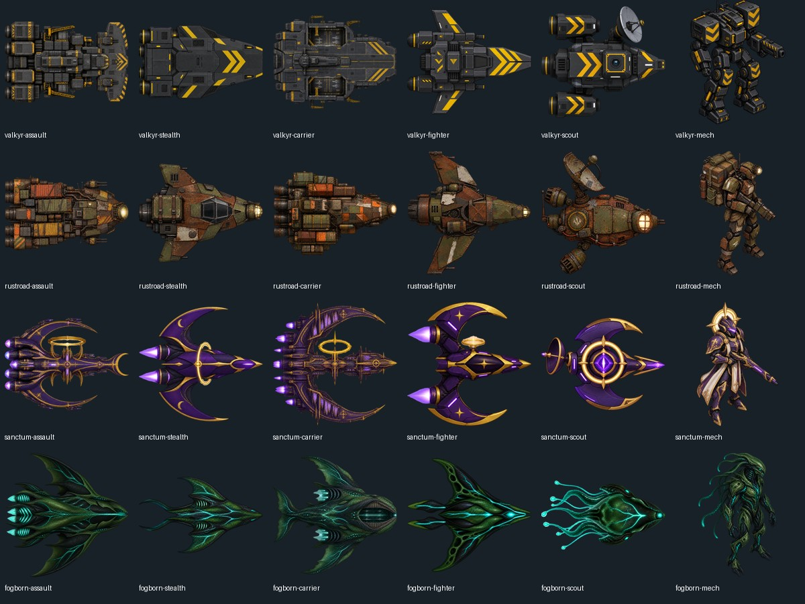

# 残り4勢力・24種の3D化再開準備（2026-11-28）

## 再開時の確認

- PR #346はマージ済み。ヘリオス・鉄鴉団の計12種が本編へ接続されている。
- 作業開始時のmainは `6728119595caaa0cf448ca138230a8a6b8214bd3`（PR #348）。既存の3D関連ブランチとPRを確認したが、この24種の生成結果や継続ブランチは見つからなかった。取得した作業ツリーに変更はなかった。前の会話の未保存メモリや実行中ジョブは調査できない。
- 今回の外部生成の最初のリクエストは、元スプライトをto3Dへ送る明示的許可がないとして自動承認審査で拒否された。ジョブIDは返されていない。別サービス経由の送信や再試行はしていない。
- 以下は**入力確認・取り込み準備**である。24種のGLB生成・軽量化・目視・本編接続は未完了。既存の12種とゲーム描画は変更していない。

## 対象画像



| 勢力 | 攻撃型 | 潜航型 | 空母 | 戦闘機 | 哨戒機 | Tech |
| --- | --- | --- | --- | --- | --- | --- |
| ヴァルキュル重工 | valkyr-assault | valkyr-stealth | valkyr-carrier | valkyr-fighter | valkyr-scout | valkyr-mech |
| ラストロード自由商船連合 | rustroad-assault | rustroad-stealth | rustroad-carrier | rustroad-fighter | rustroad-scout | rustroad-mech |
| サンクトゥム聖域教団 | sanctum-assault | sanctum-stealth | sanctum-carrier | sanctum-fighter | sanctum-scout | sanctum-mech |
| フォグボーン | fogborn-assault | fogborn-stealth | fogborn-carrier | fogborn-fighter | fogborn-scout | fogborn-mech |

元画像はすべて `prototype/assets/f2_<faction>_<role>.png`。固定コミット・Git blob SHA・SHA-256・PNG寸法・透明範囲・生成結果の格納先を [生成台帳](../tools/model_batches/remaining-factions-20261128.json) に記録した。元絵の輪郭を押し出すだけのモデルは、既存12種と同等の3D形状にはならないため採用していない。

## 再開手順

1. ユーザーから、上記24画像を外部のto3Dサービスへ送信・変換する明示的許可を得る。公開リポジトリの画像であっても、この自動審査の拒否を無視して再送しない。
2. 台帳をオフライン検証する。生成は少数ずつ開始し、返されたジョブID・状態・モデルURLを都度台帳へ記録する。既存のIDがある場合は状態確認から再開し、重複生成しない。
3. 完了したモデルを元データ用の別ディレクトリへ取得する。`--require-complete` により、未生成を含む一括処理の成功扱いを防げる。raw GLBを本編へ直接上書きしない。
4. `tools/prepare_unit_models.py` で軽量化。艦・Techは最大12,000三角形、戦闘機・哨戒機は最大5,000三角形。元データと最適化後のハッシュを保存する。
5. 各勢力の元絵と見比べ、前後・縮尺・Techの直立・透過部分を確認する。各モデルの向きは生成結果から個別に決める。
6. 検証済みモデルだけ `prototype/unit-models.js` へ追加する。既存の可視性判定後の遅延読込、同時2件、種類別プール、失敗時の元絵を維持する。キャッシュ用バージョンも更新する。
7. GLB検証・描画回帰とゲーム内確認を行う。端末FPSは実測するまで改善したと記述しない。

```sh
python tools/check_remaining_unit_batch.py
# 全モデルの生成後に通過するゲート（準備時点では意図的に失敗する）
python tools/check_remaining_unit_batch.py --require-generated
# 生成済みモデルの取得。raw/ は本編のassets/modelsとは別の作業ディレクトリ
python tools/import_generated_unit_models.py \
  --manifest tools/model_batches/remaining-factions-20261128.json \
  --dest /tmp/dark-echo-remaining-models/raw --require-complete
```

この24種以外にも、環境・霧・構造物等の立体化とTechの姿勢アニメーションが残っている。全素材の3D化完了を示す記録ではない。

## 準備段階の検証

- `python tools/check_remaining_unit_batch.py`: 24種の元画像・ハッシュ・PNG透明範囲・対応・面数上限を確認。生成完了数は0/24。
- ネットワークをモックした取り込み検証: 未生成24種ではダウンロードを一度も呼ばず、`--require-complete` で失敗する。完了扱いのGLBテストデータでは24種のIDをすべて受け付け、別々のパスへ取り込む。実モデルを検証した結果ではない。
- 台帳の重複ID、改ざんハッシュ、誤った元画像パス・URL、結果URLのない完了状態が検証に失敗することを確認。
- 既存 `test_view3d.cjs`、`test_unit_models.mjs`、`--experimental-vm-modules tools/test_unit_renderer.mjs` 通過。既存12種の回帰であり、24種の3D表示確認ではない。
