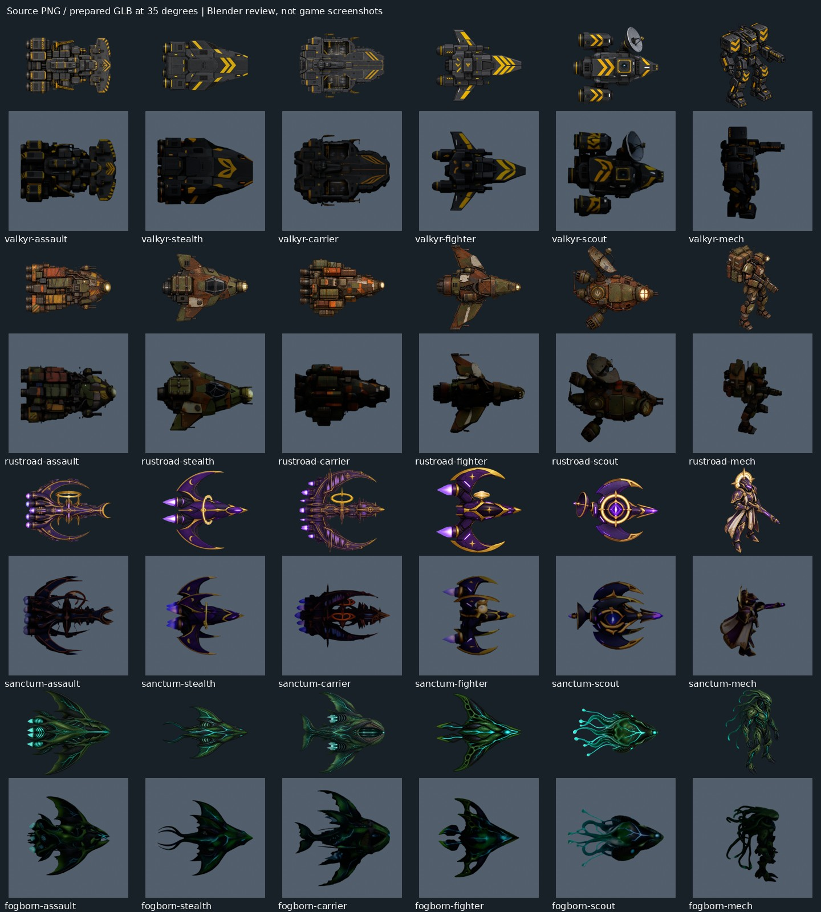

# 残り4勢力24種を本編の3Dモードへ接続（2026-11-28）

既存のヘリオス連邦・鉄鴉団12種に、ヴァルキュル重工／ラストロード自由商船連合／サンクトゥム聖域教団／フォグボーンの各6種、計24種を追加した。通常は2Dのまま、レーダータップで切り替える本編3Dモードで全6勢力・36種を表示する。ゲームシステムは共通。



## 対応範囲

| 勢力 | 攻撃型 | 潜航型 | 空母 | 戦闘機 | 哨戒機 | Tech |
| --- | --- | --- | --- | --- | --- | --- |
| ヴァルキュル重工 | valkyr-assault | valkyr-stealth | valkyr-carrier | valkyr-fighter | valkyr-scout | valkyr-mech |
| ラストロード自由商船連合 | rustroad-assault | rustroad-stealth | rustroad-carrier | rustroad-fighter | rustroad-scout | rustroad-mech |
| サンクトゥム聖域教団 | sanctum-assault | sanctum-stealth | sanctum-carrier | sanctum-fighter | sanctum-scout | sanctum-mech |
| フォグボーン | fogborn-assault | fogborn-stealth | fogborn-carrier | fogborn-fighter | fogborn-scout | fogborn-mech |

自機・敵とも同じスプライト対応表を使用。Techのfire/ready/slash/thrustは基本モデルへ対応する。骨格による姿勢アニメーションや姿勢絵に焼き込まれた武器エフェクトの立体再現は未実装。

## 生成元・再開記録

- 再開時のmainは `6728119595caaa0cf448ca138230a8a6b8214bd3`（PR #348）。PR #346はマージ済みで、既存12種は本編へ反映されていた。
- 追加24種の元画像はすべて `prototype/assets/f2_<faction>_<role>.png`。固定コミット・Git blob SHA・SHA-256・PNG寸法・透明範囲・生成ジョブID・取得先・準備後のハッシュを [生成台帳](../tools/model_batches/remaining-factions-20261128.json) に保存した。
- 外部送信が初回に自動審査で拒否された後、ユーザーから24画像をto3Dへ送信・変換する明示的許可を受けて実行した。24ジョブすべてcompletedを確認。フォグボーンTechだけ一度「Too many requests」で失敗し、他の生成終了後の再試行で成功した。失敗したIDも台帳に保持している。
- モデルは各勢力の実際の元絵から生成したもの。他勢力の流用や輪郭の押し出しではない。生成モデルの細部は元絵の完全な復元を保証するものではない。

## 軽量化

| 指標 | 追加24種・生成時 | 追加24種・本編用 |
| --- | ---: | ---: |
| 容量 | 48,862,364 bytes | 25,505,168 bytes |
| 三角形 | 686,403 | 231,997 |

- 艦・Techは最大12,000三角形、戦闘機・哨戒機は最大5,000三角形。
- 不透明材質のまま、艦・Techは1024px、小型機は512pxのJPEGテクスチャへ。元データと処理後のSHA-256を `prototype/assets/models/model-preparation-report.json` に記録。
- 既存12種のGLBは変更していない。全36種の容量は37,402,516 bytes、合計339,280三角形。ただし起動時の全件読込は行わず、描画可能・画面内の種類だけ同時2件まで読む。
- この削減はモデル容量・面数の値であり、スマホFPS改善の実測ではない。既存の全画面Canvas→CanvasTexture転送は残っている。

## 向き・縮尺の確認と補正

すべての追加GLBをBlenderで再読込し、真上・35度俯瞰で元絵と比較した。`prototype/unit-models.js` のモデル別yaw/rollが正本。

- ラストロード空母・戦闘機は横倒しで生成されたため、モデル空間のZ軸へ90度のroll補正を追加。補正後に寸法を測り、翼幅が縦方向へ立ったまま拡大される不具合を防ぐ。
- 同2種とサンクトゥム潜航型・哨戒機は、標準と逆のyawを指定。
- ラストロード哨戒機は元モデルの艦首がglTF +X方向のためyaw=0。
- Techは直立のまま高さも含めて正規化する。種類別プール、個体の透明度、既存の可視性ゲート、未読込・失敗時の元絵への復帰を継承。

## 検証

次のチェックを通過した。

```sh
python tools/check_remaining_unit_batch.py --require-generated
node tools/test_view3d.cjs
node tools/test_unit_models.mjs
node tools/test_unit_geometry.mjs
node --experimental-vm-modules tools/test_unit_renderer.mjs
```

- 24画像のハッシュ・透明範囲と全ジョブの生成完了、全36 GLBのハッシュ・面数・埋め込み画像・不透明材質を確認。
- 実際のGLBをThree.jsのGLTFLoaderでCPU解析し、36種の立体的な寸法・有限座標・材質接続と横倒し補正を確認。CPU検証では画像をプレースホルダーにするため、画像の見え方はBlenderで別に検証している。
- 実レンダラーのシーングラフで、横倒し補正後の寸法、yaw、種類別プール、フェード、フレーム間の非表示化、破棄を検証。
- 通常2D、投影と逆投影、入力、レーダー操作、stepWorldとShip.drawの既存ゲートの不変性を確認。`game.js` と `sprite-stack.js` は変更していない。
- ブラウザでは本編の出撃・レーダーからの3D開始を試した。検証環境でWebGLが無効なため、2Dへ戻り、一時停止操作ができることを確認した。

**未検証**: ゲーム内GPU合成の目視、実際の2D/3D往復、スマホ実機FPS。**未実装**: 構造物・環境・霧等の立体化、Techの関節アニメーション。全素材の3D化完了を示すものではない。

## 再現

生成台帳は各ジョブを再照会して再利用できる。元GLBは本編用ファイルと別の作業ディレクトリへ取得し、`tools/prepare_unit_models.py` で軽量化する。`tools/render3d/review_unit_models.py` はモデル別yaw/rollのJSONを受け取り、CPUのBlender比較画像を生成する。元GLBを本編用ファイルへ直接上書きしない。
