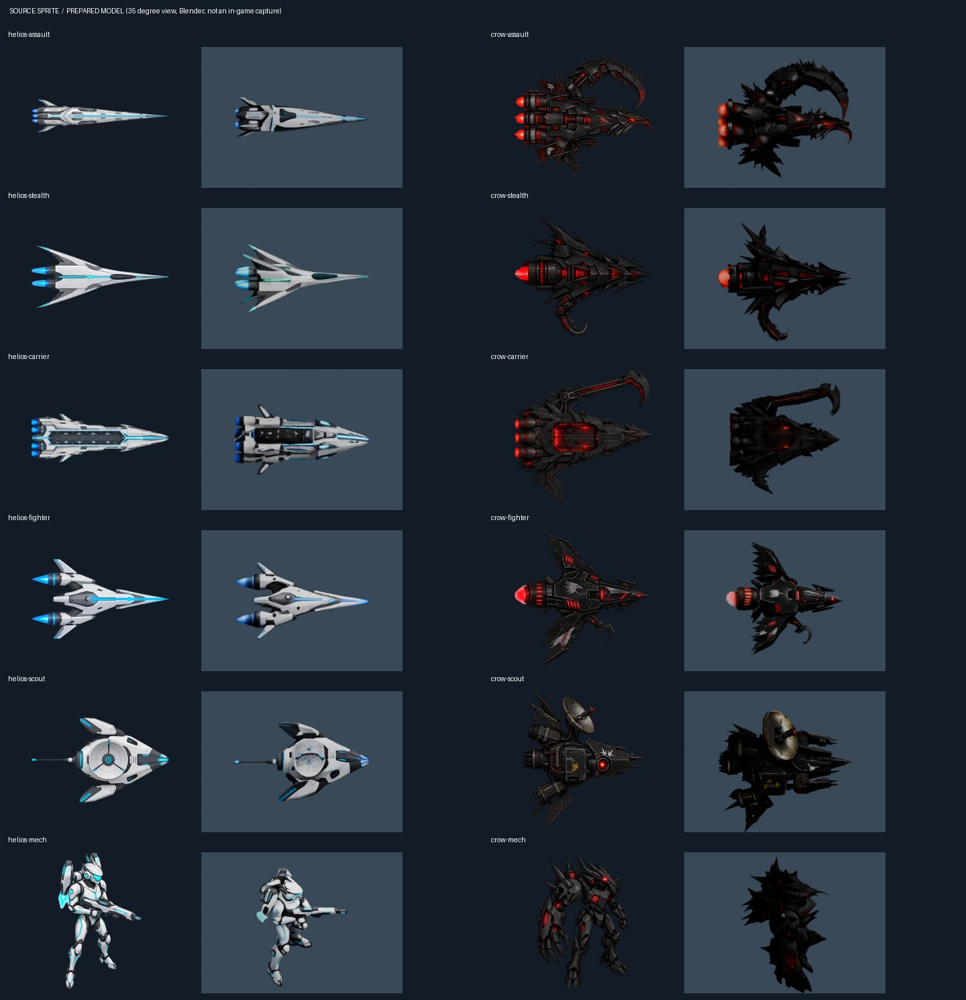

# ヘリオス・鉄鴉団12種の本編3D対応（2026-11-28）

実際に本編で使われるスプライトから生成した新規11種と既存の鉄鴉団攻撃型、計12種を軽量化し、本編の実験的3Dモードへ接続した。

| 種類 | ヘリオス連邦 | 鉄鴉団 |
| --- | --- | --- |
| 攻撃型 | [GLB](https://storage.to3d.app/generated-3d/models/2026-11-27/task_1e67dea1-279b-4f54-aa08-42eca7ee488a_model.glb) · [回転](https://storage.to3d.app/generated-3d/videos/2026-11-27/task_1e67dea1-279b-4f54-aa08-42eca7ee488a_video.mp4) · [元絵](https://raw.githubusercontent.com/s1-1985/Dark-Higgs/fde9c24afed1b2be4e3bb0576af4daeb3745f614/prototype/assets/f2_helios_assault.png) | [既存の導入済みGLB](../prototype/assets/models/crow-assault.glb) |
| 潜航型 | [GLB](https://storage.to3d.app/generated-3d/models/2026-11-27/task_0141ee61-f5b4-41ea-965a-f4cfea138da6_model.glb) · [回転](https://storage.to3d.app/generated-3d/videos/2026-11-27/task_0141ee61-f5b4-41ea-965a-f4cfea138da6_video.mp4) · [元絵](https://raw.githubusercontent.com/s1-1985/Dark-Higgs/fde9c24afed1b2be4e3bb0576af4daeb3745f614/prototype/assets/f2_helios_stealth.png) | [GLB](https://storage.to3d.app/generated-3d/models/2026-11-27/task_307c9b85-1582-42a1-8837-784e5762a9ee_model.glb) · [回転](https://storage.to3d.app/generated-3d/videos/2026-11-27/task_307c9b85-1582-42a1-8837-784e5762a9ee_video.mp4) · [元絵](https://raw.githubusercontent.com/s1-1985/Dark-Higgs/fde9c24afed1b2be4e3bb0576af4daeb3745f614/prototype/assets/f2_crow_stealth.png) |
| 空母 | [GLB](https://storage.to3d.app/generated-3d/models/2026-11-27/task_125f234b-f866-4971-9131-751b9b2a4e6a_model.glb) · [回転](https://storage.to3d.app/generated-3d/videos/2026-11-27/task_125f234b-f866-4971-9131-751b9b2a4e6a_video.mp4) · [元絵](https://raw.githubusercontent.com/s1-1985/Dark-Higgs/fde9c24afed1b2be4e3bb0576af4daeb3745f614/prototype/assets/f2_helios_carrier.png) | [GLB](https://storage.to3d.app/generated-3d/models/2026-11-27/task_d941edb8-42e6-4eab-823e-f44a8649cd50_model.glb) · [回転](https://storage.to3d.app/generated-3d/videos/2026-11-27/task_d941edb8-42e6-4eab-823e-f44a8649cd50_video.mp4) · [元絵](https://raw.githubusercontent.com/s1-1985/Dark-Higgs/fde9c24afed1b2be4e3bb0576af4daeb3745f614/prototype/assets/f2_crow_carrier.png) |
| 戦闘機 | [GLB](https://storage.to3d.app/generated-3d/models/2026-11-27/task_fdb6b353-3388-4699-842f-fff79516b0b9_model.glb) · [回転](https://storage.to3d.app/generated-3d/videos/2026-11-27/task_fdb6b353-3388-4699-842f-fff79516b0b9_video.mp4) · [元絵](https://raw.githubusercontent.com/s1-1985/Dark-Higgs/fde9c24afed1b2be4e3bb0576af4daeb3745f614/prototype/assets/f2_helios_fighter.png) | [GLB](https://storage.to3d.app/generated-3d/models/2026-11-27/task_240ac054-2697-4abe-8df0-bf776b4b47d9_model.glb) · [回転](https://storage.to3d.app/generated-3d/videos/2026-11-27/task_240ac054-2697-4abe-8df0-bf776b4b47d9_video.mp4) · [元絵](https://raw.githubusercontent.com/s1-1985/Dark-Higgs/fde9c24afed1b2be4e3bb0576af4daeb3745f614/prototype/assets/f2_crow_fighter.png) |
| 哨戒機 | [GLB](https://storage.to3d.app/generated-3d/models/2026-11-27/task_42102e5a-580f-4909-923f-df4a5c7b9e40_model.glb) · [回転](https://storage.to3d.app/generated-3d/videos/2026-11-27/task_42102e5a-580f-4909-923f-df4a5c7b9e40_video.mp4) · [元絵](https://raw.githubusercontent.com/s1-1985/Dark-Higgs/fde9c24afed1b2be4e3bb0576af4daeb3745f614/prototype/assets/f2_helios_scout.png) | [GLB](https://storage.to3d.app/generated-3d/models/2026-11-27/task_21af82f8-e93c-44ea-95d3-05cfc556e2ce_model.glb) · [回転](https://storage.to3d.app/generated-3d/videos/2026-11-27/task_21af82f8-e93c-44ea-95d3-05cfc556e2ce_video.mp4) · [元絵](https://raw.githubusercontent.com/s1-1985/Dark-Higgs/fde9c24afed1b2be4e3bb0576af4daeb3745f614/prototype/assets/f2_crow_scout.png) |
| Tech | [GLB](https://storage.to3d.app/generated-3d/models/2026-11-27/task_09b14218-d6e1-4463-aace-181a8f533281_model.glb) · [回転](https://storage.to3d.app/generated-3d/videos/2026-11-27/task_09b14218-d6e1-4463-aace-181a8f533281_video.mp4) · [元絵](https://raw.githubusercontent.com/s1-1985/Dark-Higgs/fde9c24afed1b2be4e3bb0576af4daeb3745f614/prototype/assets/f2_helios_mech.png) | [GLB](https://storage.to3d.app/generated-3d/models/2026-11-27/task_9e7ddf87-4cd2-46a7-96c2-4064fbf5e1b3_model.glb) · [回転](https://storage.to3d.app/generated-3d/videos/2026-11-27/task_9e7ddf87-4cd2-46a7-96c2-4064fbf5e1b3_video.mp4) · [元絵](https://raw.githubusercontent.com/s1-1985/Dark-Higgs/fde9c24afed1b2be4e3bb0576af4daeb3745f614/prototype/assets/f2_crow_mech.png) |

## 本編への組込み

12種（既存の鉄鴉団攻撃型＋新規11種）を `prototype/assets/models/` に格納し、レーダーで切り替える既存3Dモードへ接続した。通常2D、戦闘・探知・COMは共通。`stepWorld` と `Ship.draw` 全体の不変性を既存基準コミットとの比較で検証した。

`prototype/unit-models.js` に元絵とモデルの厳密な対応を定義。他勢力や未対応のミサイル・強襲艇は元絵を維持する。ヘリオス戦闘機と鉄鴉団潜航型の前後を個別補正。Techは立体の直立モデルとして高さも含めて縮尺を決める。

読み込みは可視性判定・画面外除外の後、同時2件まで。種類別プールで形状・テクスチャを共有し、フレームごとに表示をリセットする。未読込・失敗した種類はスプライトのまま。ドローンの最低表示寸法と死亡等の透明度を引き継ぐ。

Techの姿勢絵（fire/ready/slash/thrust）は基本モデルへ対応付けた。関節を動かす3Dアニメーションはまだ無く、姿勢絵に焼き込まれた刀身や閃光は再現されない。既存の手続きエフェクトと判定処理は変更していない。



## 軽量化と再現方法

| 対象 | 三角形上限 | テクスチャ |
|---|---:|---:|
| 艦・Tech | 12,000 | 1024px JPEG / quality 90 |
| 戦闘機・哨戒機 | 5,000 | 512px JPEG / quality 90 |

12種合計: **260,012→107,283三角形、22,337,056→11,897,348 bytes**。個別の元データ／最適化後SHA-256・容量・面数は `prototype/assets/models/model-preparation-report.json`。`generation-import-report.json` は取得時の未軽量化11種の記録。

元スプライトの固定コミットとBlob SHA・生成ジョブ・取得先は `tools/model_batches/helios-crow-20261128.json`。認証情報は含まない。鉄鴉団潜航型の最初の失敗ジョブと成功した再試行ジョブも保存した。

```sh
# 元データの再取得。軽量化済みの本編GLBに上書きしないこと。
python3 tools/import_generated_unit_models.py --dest /tmp/dark-echo-raw
git show fde9c24afed1b2be4e3bb0576af4daeb3745f614:prototype/assets/models/crow-assault.glb > /tmp/dark-echo-raw/crow-assault.glb
blender -b -t 6 --python tools/prepare_unit_models.py -- /tmp/dark-echo-raw /tmp/dark-echo-prepared
```

Blender 4.3.2で面数を削減し、UV・法線を保持。不透明材質のみJPEG化する。生成URLのfallbackは一時URLであるため、期限切れの場合は保存したjob_idから同じ生成結果を取得する。再生成とは区別する。

## 検証と残作業

```sh
node tools/test_view3d.cjs
node tools/test_unit_models.mjs
node --experimental-vm-modules tools/test_unit_renderer.mjs
```

- 全12種のGLB構造・埋込素材・実面数・ハッシュ、厳密な元絵対応を検証。
- 実際のThreeシーングラフで種類別の再利用・フレームごとの非表示・向き・縮尺・透明度・破棄をCPUテスト。遅延読込の重複抑制・同時2件・一部失敗・破棄後の完了も検証。
- 元絵と生成物を上・斜め・正面から比較。軽量化後の全12種をBlenderへ再読込し35度俯瞰で確認。元絵から見えない側面・背面は生成による補完であり、完全一致ではない。
- 更新した本編でヘリオスを選んで2D出撃、レーダーによる3D起動失敗から2D復帰を確認。検証ブラウザはWebGL無効のため、ゲーム内GPU合成、2D/3D往復の見た目、スマホ実機のFPSは未検証。
- 全画面Canvas→CanvasTextureの毎フレーム転送は残っている。この面数・容量削減だけで20fps問題が解消したとは主張しない。
- 残り4勢力、環境・構造物の立体化、ヒッグスの立体シェーダーは未実装。
