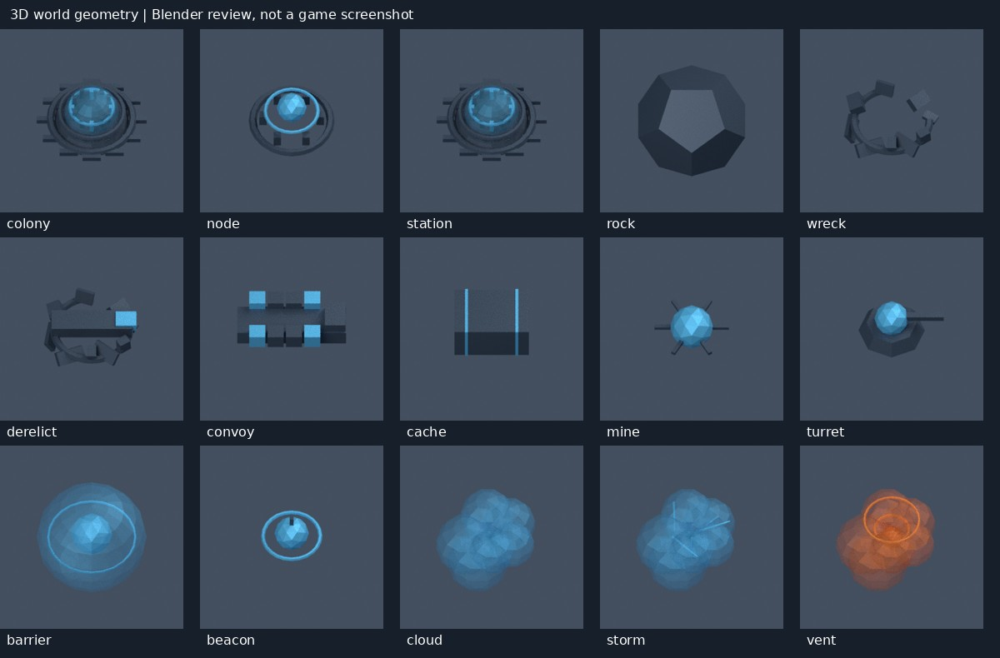
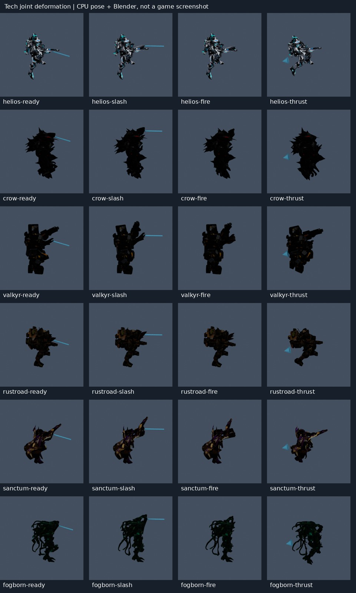

# 構造物・環境・霧・Tech姿勢の3D描画（2026-11-28）

PR #349のユニット36種対応に、残っていた構造物・地形・自然現象・小型物・Tech姿勢を接続した。起動時は通常2D、レーダーで本編3Dへ切り替える。戦闘・探知・COMの原則や更新式は共通。

**実装は追加済み。ただし、本編でのGPU合成の目視とスマホ実機FPSは未検証である。** この記録で「実機確認も含め全完了」とは扱わない。

## 構造物と環境



`prototype/world3d.js` は、以下を軽量な立体メッシュとして組み立てる。外部生成画像を追加送信する方法ではなく、ローカルの形状定義を使う。元絵の細部を完全再現した高精細モデルではない。

- コロニー・ノード・補給ステーション: 環、支柱、都市ブロック、発光コア、半球のドーム。
- 岩石・残骸・難破船: 多面体、破断した環、破片と船体。
- 輸送船・コンテナ・機雷・砲台・バリア・ブイ／囮・ノイズメーカー・ミサイル・強襲艇。
- 雲・磁気嵐・熱泉・煙幕: 立体の雲塊、放電、発光する環、半透明の局所ボリューム。

同じ材質の部品を結合し、1種類の形状は最大3メッシュ。岩石160個は1つのInstancedMeshへまとめ、残骸も同じ方法でまとめる。個体ごとの透明度は専用属性で保持。上限は岩石160・残骸80・その他各40・各ユニット128で、超えた分は従来の絵を描く。読み込み・生成中や失敗時も元絵を残す。

## 表示順と情報の制限

描画順は、宇宙の遠景 → 立体の地形・自然現象 → 従来の暗幕と2D効果 → 視界で制限した立体霧 → 局所煙幕 → 描画可能な立体ユニット・構造物 → HUD。

地形をGPUへ描いた後、成功した場合だけ元Canvasを空にし、以後の暗幕・効果を別の合成層にする。これにより、岩石や残骸が暗幕の手前に浮き上がる問題を避ける。

`drawWorldImage` と `drawSpriteStack` の橋渡しは、既存の描画呼び出し位置で働く。未発見の難破船、視界外の輸送船、未特定の自然現象、未探知の敵などを、3D用に別のリストから列挙しない。誤認・既知物は従来の描画用位置を使う。3D側へ敵一覧や真の敵位置を渡す追加経路はない。

通常2Dでは従来のdrawImageへそのまま戻る。`stepWorld` と `Ship.draw` の既存判定は基準コミットとの比較で不変を確認した。Projectile・Droneへの変更も描画用drawImageの橋渡しのみ。

## ヒッグスの立体霧

`prototype/fog3d.js` で、既存の雲の密度Canvasを高さのある層としてレイマーチする。既存のビームによる晴れ・航跡・流体的な模様を反映済みのCanvasを入力に使うため、別の探知用濃度や視界判定は作らない。

- スマホ6ステップ／その他12ステップ。視界がない画素は早期終了。
- 高さごとの視差、立体ノイズ、光の濃淡を積分する。
- 密度をずらして読むだけでは視界外へ漏れるため、**最終的な出力画素でも既存の暗幕マスクを掛ける**。
- 霧表示OFF、マップ表示、2D、敵視点リプレイでは既存のモード条件に従う。

実際のGLSLをMesaのOpenGL ESでコンパイル・リンク・描画し、6／12ステップで視界外のアルファが0、表示無効・全暗幕・密度0の画素がすべて0であることを確認した。この検査はオフスクリーンのシェーダー単体検証であり、本編ブラウザのGPU合成や端末FPSを示さない。

## Techの姿勢



`prototype/tech3d.js` は、既存の骨格を持たないGLBへ11本の骨と領域別の重みを付ける。頭・胴・左右の腕／前腕・脚／膝を動かす。各個体に別の骨格を持たせ、形状とテクスチャは種類ごとに共有する。

既存スプライトの姿勢名（ready／slash／fire／thrust）とシミュレーション時刻だけで、構え・斬撃・射撃の反動・突進の手脚を補間する。サーベル、発砲光、推進炎も立体表示する。武器エフェクトは重み付きの前腕頂点から手元を推定して取り付ける。停止中は時刻が進まず、アニメーションも止まる。

これは自動の領域分割によるリグであり、各勢力の関節を人手で厳密に造形・調整したものではない。元絵の武器や衣装の細部を完全再現する保証はない。元GLBの静止頂点とUVは維持し、既存のダメージ・射程・命中・格闘判定は変更しない。

## 確認済みと未確認

次を通過した。

```sh
node --check prototype/game.js
node tools/test_view3d.cjs
node tools/test_unit_models.mjs
node tools/test_unit_geometry.mjs
node --experimental-vm-modules tools/test_unit_renderer.mjs
node tools/test_world3d.mjs
node tools/test_tech3d.mjs
python tools/test_fog_shader.py
```

- 通常2D・投影・入力・レーダー操作、既存の戦闘更新と敵の描画ゲートの不変性。
- 全36 GLBのハッシュ・面数・実シーングラフ。
- 地形→暗幕→霧→煙幕→ユニットの順、160個の岩石が1つのInstancedMeshになること、透明度、上限、翌フレームで残像が残らないこと。
- 6勢力の実際のTech GLBに対する静止頂点の維持と4姿勢の関節変形・有限な重み。
- 15種類の立体形状と24姿勢をBlenderで描画して確認。
- ブラウザでヴァルキュル出撃→レーダー→WebGL無効による2D復帰→一時停止を確認。更新されたモジュールの読込時に構文・リンクのエラーはなかった。

**未確認**: 本編で全パスをGPU合成した際の見た目、正常な2D/3D往復、スマホの安定性・FPS。実機性能の改善や完全な元絵再現を確認済みとは記載しない。

## 比較画像の再現

```sh
node tools/render3d/export_world_review.mjs /tmp/dark-echo-world-review/data
blender -b -t 4 --python-exit-code 1 --python tools/render3d/render_world_review.py -- \
  /tmp/dark-echo-world-review/data /tmp/dark-echo-world-review/images
```

画像は形状と変形の確認用で、本編の合成順・霧・照明・操作感を再現したゲーム画面ではない。
